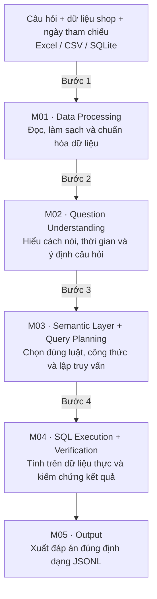

# ZAIC_DataMate

## 1. Mục tiêu và nguyên tắc thiết kế
DataMate nhận câu hỏi tiếng Việt, dữ liệu của một shop và ngày tham chiếu; hệ thống tính trên dữ liệu thực rồi xuất đáp án đúng định dạng JSONL. Kiến trúc gồm **5 phần chính**, từ xử lý dữ liệu đến xuất kết quả.
**AI hiểu câu hỏi và hỗ trợ lập kế hoạch. Code áp luật, truy vấn, tính toán, kiểm chứng và định dạng đáp án.** Mọi giá trị trả lời phải có căn cứ từ dữ liệu hoặc phép tính được cho phép.

### 1.1. Đầu vào và đầu ra

| Thành phần | Nội dung |
| --- | --- |
| Câu hỏi | Record trong `questions.jsonl`: `id`, `business_id`, `question`, `as_of_date` |
| Dữ liệu shop | File Excel, CSV hoặc SQLite trong thư mục của shop, kèm README |
| Nguồn luật | `rulebook.md` và `calendar.csv` |
| Đầu ra chấm điểm | `submission.jsonl`, mỗi câu hỏi một record |
| Đầu ra nội bộ | Nguồn dữ liệu, kế hoạch, truy vấn, phép kiểm tra và trạng thái xử lý để truy vết |

### 1.2. Các quyết định nền tảng
- Định nghĩa công thức nghiệp vụ một lần trong semantic layer, dùng chung cho các cách diễn đạt khác nhau.
- Dùng `as_of_date` của từng câu hỏi để xác định thời gian. Không lấy ngày máy chạy làm “hôm nay”.
- Chuẩn bị dữ liệu một lần cho mỗi phiên bản dữ liệu shop, sau đó tái sử dụng cho nhiều câu hỏi.
- Phân biệt dữ liệu thực sự thiếu với lỗi hệ thống hoặc câu hỏi chưa giải chắc chắn.
- Khám phá cấu trúc shop tại runtime; không đóng sẵn đáp án hoặc chọn logic riêng bằng ID của 14 shop public.


## 2. Sơ đồ tổng thể


## M01 — Data Processing
Biến file thô của shop thành dữ liệu có cấu trúc thống nhất, biết rõ mỗi dòng đại diện cho điều gì, có thể truy vấn và truy ngược về nguồn.
Chi tiết: 
[M01-DataProcessing](M01-DataProcessing.md)

## M02 — Question Understanding
Hiểu người hỏi muốn biết điều gì, nói tới đối tượng nào và dùng biểu thức thời gian nào, kể cả cách viết tắt, không dấu hoặc tiếng Việt đời thường.

Chi tiết: 
[M02-QuestionUnderstanding](M02-QuestionUnderstanding.md)
## M03 — Semantic Layer + Query Planning
Chuyển ý định câu hỏi thành cách tính đúng nghiệp vụ và kế hoạch truy vấn có thể kiểm tra được.
[M03-SemanticLayer+QueryPlanning](M03-SemanticLayer+QueryPlanning.md)

## M04 — SQL Execution + Verification
Thực thi kế hoạch trên dữ liệu thật và xác nhận kết quả phù hợp với yêu cầu. SQL chạy thành công chưa đủ để coi đáp án là đúng.
Chi tiết: 
[M04-SQLExecutionVerification](M04-SQLExecutionVerification.md)

## M05 — Output
Chuyển kết quả đã kiểm chứng hoặc quyết định xử lý thành record JSONL đúng chuẩn chấm điểm.
Chi tiết: 
[M05-Output](M05-Output.md)


## Cấu trúc mã nguồn đề xuất

```text
uwwu/
├── ARCHITECTURE.md
├── PROJECT_STRUCTURE.md
├── DataMate_Document.docx
├── rulebook.md
├── calendar.csv
├── questions.jsonl
├── data/
├── src/datamate/                 # cấu trúc triển khai đề xuất
│   ├── m01_data_processing/      # readers, normalization, catalog, lineage
│   ├── m02_question_understanding/ # question parser, intent, entity candidates
│   ├── m03_semantic_query_planning/ # metrics, time resolver, domains, compiler
│   ├── m04_execution_verification/ # SQL validator, worker, result checks
│   ├── m05_output/               # rounding, schemas, JSONL serializer
│   ├── shared/                   # contracts, model adapter, common errors
│   ├── runtime/                  # runner, scheduler, checkpoint, trace
│   └── cli.py
├── configs/
├── prompts/
├── tests/                        # kiểm tra theo module và toàn luồng
├── scripts/
├── pyproject.toml
├── dependency.lock
└── Dockerfile
```