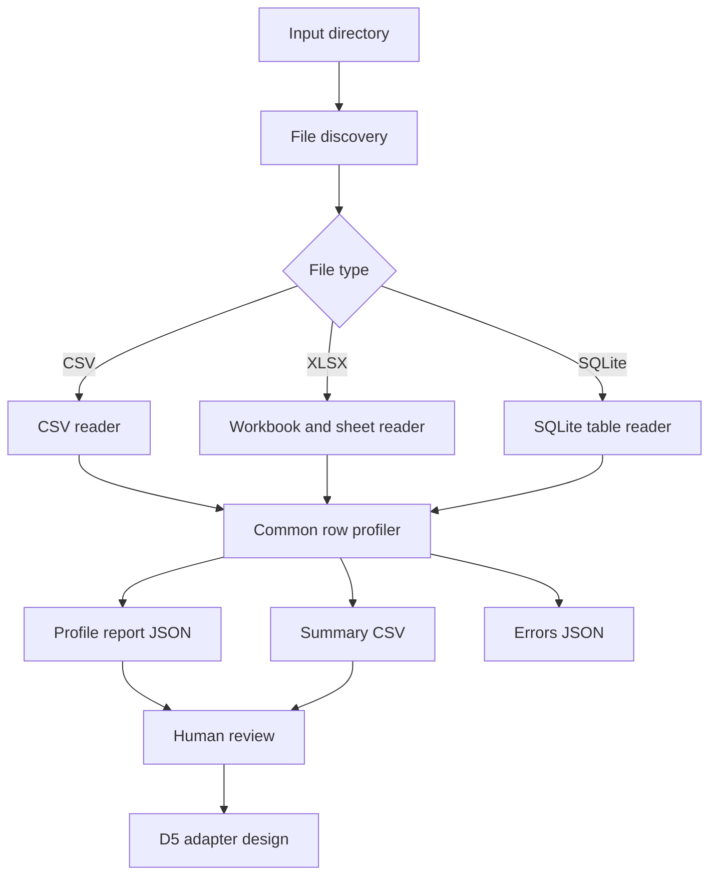

# D4 – Generic Profiler (M01 Data Processing)

## 1. Mục tiêu

D4 xây dựng một **Generic Profiler** để khảo sát dữ liệu thực tế của 14 shop trước khi viết adapter.
Profiler trả lời các câu hỏi định lượng: bảng có bao nhiêu dòng/cột, cột nào thiếu dữ liệu,
kiểu giá trị quan sát được là gì, có bao nhiêu giá trị phân biệt, cột số có miền giá trị nào,
và có dấu hiệu trùng dòng/khóa ứng viên hay không.

**Ranh giới trách nhiệm:** Profiler chỉ đo lường và ghi nhận bằng chứng. Nó KHÔNG chuẩn hóa
tên cột, đổi đơn vị, parse tiền tệ thành số chuẩn, gộp dòng, suy luận quan hệ nghiệp vụ,
hay sửa dữ liệu nguồn. Những việc đó thuộc adapter/normalization ở các bước sau.

## 2. Phạm vi hỗ trợ trong MVP

| Nguồn | Đơn vị profile | Cách đọc |
|---|---|---|
| CSV | Một file | Đọc streaming theo dòng |
| XLSX | Một worksheet | `openpyxl` read-only |
| SQLite | Một table | Đọc schema và dữ liệu qua `sqlite3` |

Không hỗ trợ XLS cũ, PDF, ảnh scan hoặc file mã hóa ở MVP. File không đọc được phải được
ghi thành lỗi trong report, không được âm thầm bỏ qua.

## 3. Đầu ra

Mỗi đối tượng dữ liệu có:
- `source`: file, sheet/table, định dạng và vị trí header.
- `shape`: số dòng dữ liệu, số cột.
- `columns[]`: tên cột gốc, null count/rate, distinct estimate, mẫu giá trị,
  kiểu quan sát (`integer`, `float`, `date`, `boolean`, `text`, `empty`, `mixed`),
  thống kê số cơ bản nếu áp dụng.
- `duplicate_rows`: số dòng trùng hoàn toàn (so sánh trên giá trị đọc được).
- `candidate_key_columns`: cột đơn có giá trị không null và distinct bằng row count.
- `warnings`: header mơ hồ, tên cột trống/trùng, giới hạn distinct, lỗi đọc.

Report tổng thể là JSON; CSV summary giúp xem nhanh toàn bộ 14 shop.

## 4. Header detection

- CSV: mặc định dòng đầu là header; có thể override bằng `header_row` (1-based).
- XLSX: nếu không cấu hình, chấm điểm tối đa 10 dòng đầu dựa trên số ô có giá trị,
  tỷ lệ chuỗi và độ đa dạng. Đây là **header candidate**, không phải sự thật nghiệp vụ.
- Khi file có tiêu đề nhiều dòng (ví dụ dev_013) hoặc tiêu đề báo cáo phía trên header
  (ví dụ dev_001/dev_002), cần override rõ ràng trong config. Không tự ghép header nhiều dòng.

`configs/profiler_overrides.example.json` minh họa cách chỉ định header cho các sheet.
Không được hardcode quy tắc riêng của một shop vào generic profiler.

## 5. Cách chạy

Từ repo root:

```bash
python -m pip install openpyxl
python scripts/run_profiler.py --input public_test/data --output reports/profiling/d4
```

Có thể profile một shop:

```bash
python scripts/run_profiler.py --input public_test/data/dev_001 --output reports/profiling/dev_001
```

Dùng override:

```bash
python scripts/run_profiler.py --input public_test/data --output reports/profiling/d4 \
  --overrides configs/profiler_overrides.json
```

Tạo ra:
- `profile_report.json`: kết quả chi tiết.
- `profile_summary.csv`: một dòng cho mỗi file/sheet/table.
- `profile_errors.json`: lỗi đọc nếu có.

## 6. Cách đọc kết quả và giới hạn

- `distinct_count` là exact trong giới hạn `distinct_cap`; nếu vượt giới hạn sẽ bị đánh dấu
  `distinct_is_capped=true` và không được dùng như cardinality chính xác.
- `duplicate_rows` chỉ tính trùng toàn bộ dòng, không có nghĩa là giao dịch trùng nghiệp vụ.
- `candidate_key_columns` chỉ là khóa ứng viên kỹ thuật, chưa chứng minh khóa nghiệp vụ.
- `observed_type` dựa trên giá trị đọc được và heuristic; chuỗi như `55k`, `55.000đ`,
  ngày viết dạng text có thể bị phân loại là `text`.
- Dòng tổng cộng, dòng ghi chú, dòng điều chỉnh và dòng rỗng có thể làm sai lệch profile.
  Cần adapter-specific validation để phân loại chúng.
- Các con số không thay thế kiểm tra đối soát hoặc kiểm tra quan hệ giữa các bảng.

## 7. Kiến trúc



## 8. Tiêu chí nghiệm thu D4

1. Quét được thư mục nhiều shop và phát hiện CSV/XLSX/SQLite.
2. Mỗi worksheet/table được profile riêng; không gộp các nguồn khác grain.
3. Có row count, column count, null rate, observed type, sample values.
4. Có duplicate-row count và candidate key heuristic.
5. Lỗi của một file không làm dừng toàn bộ batch.
6. Có test cho CSV, null, duplicate, header override và file lỗi.
7. Report ghi rõ giới hạn heuristic; không tự động biến dữ liệu nguồn thành canonical schema.

## 9. Việc cần làm sau D4

- Chạy profiler trên toàn bộ `public_test/data` (14 shop).
- Đọc summary và chọn các trường hợp cần kiểm tra sâu: multi-row header, cột tiền dạng text,
  nhiều bảng liên kết, dòng điều chỉnh, nhiều grain.
- D5 mới thiết kế adapter theo từng family; không viết 14 adapter chỉ dựa vào tên file.
